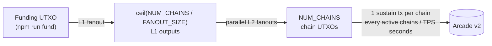

<div align="center">

# 🚀&nbsp;&nbsp;tx-gen

**High-throughput BSV transaction generator: bootstraps thousands of UTXO chains from one funded output and drives them at a target TPS.**

<br/>

<a href="https://github.com/bsv-blockchain/tx-gen/releases"></a>
<a href="https://golang.org/"></a>
<a href="https://github.com/bsv-blockchain/tx-gen/blob/master/LICENSE"></a>

<br/>

<table align="center" border="0">
  <tr>
    <td align="right">
       <code>CI / CD</code> &nbsp;&nbsp;
    </td>
    <td align="left">
       <a href="https://github.com/bsv-blockchain/tx-gen/actions"></a>
       <a href="https://github.com/bsv-blockchain/tx-gen/actions"></a>
    </td>
    <td align="right">
       &nbsp;&nbsp;&nbsp;&nbsp; <code>Quality</code> &nbsp;&nbsp;
    </td>
    <td align="left">
       <a href="https://codecov.io/gh/bsv-blockchain/tx-gen"></a>
    </td>
  </tr>

  <tr>
    <td align="right">
       <code>Security</code> &nbsp;&nbsp;
    </td>
    <td align="left">
       <a href="https://scorecard.dev/viewer/?uri=github.com/bsv-blockchain/tx-gen"></a>
       <a href=".github/SECURITY.md"></a>
    </td>
    <td align="right">
       &nbsp;&nbsp;&nbsp;&nbsp; <code>Community</code> &nbsp;&nbsp;
    </td>
    <td align="left">
       <a href="https://github.com/bsv-blockchain/tx-gen/graphs/contributors"></a>
       <a href="https://deepwiki.com/bsv-blockchain/tx-gen"></a>
    </td>
  </tr>
</table>

</div>

<br/>
<br/>

<div align="center">

### <code>Project Navigation</code>

</div>

<table align="center">
  <tr>
    <td align="center" width="33%">
       🚀&nbsp;<a href="#-quick-start"><code>Quick&nbsp;Start</code></a>
    </td>
    <td align="center" width="33%">
       🔧&nbsp;<a href="#-configuration"><code>Configuration</code></a>
    </td>
    <td align="center" width="33%">
       🔌&nbsp;<a href="#-http-api"><code>HTTP&nbsp;API</code></a>
    </td>
  </tr>
  <tr>
    <td align="center">
       📈&nbsp;<a href="#-monitoring"><code>Monitoring</code></a>
    </td>
    <td align="center">
       📚&nbsp;<a href="#-documentation"><code>Documentation</code></a>
    </td>
    <td align="center">
       🧪&nbsp;<a href="#-examples--tests"><code>Examples&nbsp;&&nbsp;Tests</code></a>
    </td>
  </tr>
  <tr>
    <td align="center">
       ⚡&nbsp;<a href="#-benchmarks"><code>Benchmarks</code></a>
    </td>
    <td align="center">
       🛠️&nbsp;<a href="#%EF%B8%8F-code-standards"><code>Code&nbsp;Standards</code></a>
    </td>
    <td align="center">
       🤖&nbsp;<a href="#-ai-usage--assistant-guidelines"><code>AI&nbsp;Usage</code></a>
    </td>
  </tr>
  <tr>
    <td align="center">
       🤝&nbsp;<a href="#-contributing"><code>Contributing</code></a>
    </td>
    <td align="center">
       👥&nbsp;<a href="#-maintainers"><code>Maintainers</code></a>
    </td>
    <td align="center">
       ⚖️&nbsp;<a href="#-license"><code>License</code></a>
    </td>
  </tr>
</table>
<br/>

## 📖 Overview

**tx-gen** is a load generator for BSV mainnet. From a single funded output it builds a fleet of independent UTXO chains, then keeps each chain spending its own previous output so that the fleet together sustains a target rate of transactions per second. The rate changes instantly over an authenticated HTTP API, every step survives a crash, and the service reports its health, metrics, and every mainnet reorg it sees.

### How It Works



1. **Fund.** A new instance polls WhatsOnChain for a UTXO locked to its script. The [funding script](scripts/initial-funding.ts) plans the run, configures the server, and funds that output from a BSV Desktop wallet.
2. **Bootstrap.** One L1 fanout and a set of parallel L2 fanouts turn the funding UTXO into `NUM_CHAINS` chain UTXOs. Bootstrap is a persisted state machine (`none` → `l1_done` → `l2_partial` → `l2_done`): it retries transient failures, resumes from the last completed stage, and starts no chains until the L2 fanout is complete.
3. **Sustain.** Each running chain broadcasts a one-in, one-out transaction every `active chains / TPS` seconds, paying the sustain fee each hop, until its output is spent down to zero.
4. **Resume.** Chain tips and in-flight broadcasts live in a BoltDB file. After a restart tx-gen replays any interrupted broadcast and picks the chains up where they stopped, without a new bootstrap.

### Core Capabilities
- **Instant rate control**: one TPS target for the whole fleet; changing it wakes every chain at once, and `0` pauses without losing state
- **Crash safety**: every broadcast is written to disk before it is sent and committed when Arcade accepts it
- **Two transaction modes**: instance-tagged push/drop scripts by default, or signed P2PKH
- **EF broadcasting**: transactions go to [Arcade v2](https://arcade-v2-us-1.bsvblockchain.tech) in Extended Format, through a bounded, retrying, connection-pooled client
- **Observability**: Prometheus metrics, a provisioned Grafana dashboard, structured `slog` logs, health and readiness probes, and Slack reorg reports

### Transaction Modes

| Mode | Enabled by | Locking script | Unlocking | Default fee/hop |
|------|------------|----------------|-----------|----------------:|
| `tagged_drop` | default | `OP_PUSHBYTES_6 <INSTANCE_ID as 6 bytes> OP_DROP` | `OP_TRUE` | 7 sat |
| `p2pkh` | `PRIVATE_KEY` set | P2PKH to the key's mainnet address | signature | 20 sat |

`INSTANCE_ID` is trimmed and normalized to exactly six UTF-8 bytes (padded with spaces, never splitting a character), so every instance has its own script hash and its own UTXOs on WhatsOnChain.

### Chain Math

| Metric | Formula | Example |
|--------|---------|---------|
| Chain length | `ceil(value / fee)` hops | 1,000 sat at 7 sat/hop = 143 hops |
| Interval per chain | `active chains / TPS` | 9,600 chains at 16 TPS = 600 s |
| Run time | chain length × interval | 143 hops × 10 min ≈ 23.8 hours |
| Fanout fee | 100 sat/KB of the serialized fanout, rounded up | 100 outputs (1,752 bytes) = 176 sat |

<br/>

## 🚀 Quick Start

**Requirements:** [Go 1.27](https://go.dev/doc/go1.27) or newer (or Docker), Node.js 22.6+ for the funding script, a [BSV Desktop](https://github.com/bsv-blockchain/bsv-desktop) wallet with funds for a fresh run, and network access to WhatsOnChain and Arcade.

**1. Install** the binary, or build the container image:

```shell script
go install github.com/bsv-blockchain/tx-gen/cmd/tx-gen@latest
```

```shell script
docker build -t tx-gen .
```

**2. Start the server** with the two required settings:

```shell script
export ADMIN_TOKEN=change-me INSTANCE_ID=runner1
tx-gen
```

It logs its script hash and waits for the funding UTXO.

**3. Fund the run** from a second terminal while the server is up:

```shell script
npm install
ADMIN_TOKEN=change-me INSTANCE_ID=runner1 npm run fund
```

The script asks for the target TPS and run duration, derives `numChains` and `fanoutSize`, applies them with the TPS and sustain fee through `POST /config`, then funds the output from the wallet and broadcasts it to Arcade. tx-gen detects it, bootstraps, and starts generating at the target TPS. To fund a deployed instance, pass its URL: `npm run fund https://tx-gen.example.com`. The script also reads a `.env` file from the current directory; its optional settings are listed in the [runbook](docs/runbook.md#-fund-a-new-instance).

The funding script creates the default tagged-drop output. In P2PKH mode (`PRIVATE_KEY` set), fund the instance with a normal payment to the address in its `lock script ready` log line.

**4. Control it** at any time:

```shell script
curl -X POST localhost:8080/config \
  -H "Authorization: Bearer $ADMIN_TOKEN" -H "Content-Type: application/json" \
  -d '{"tps": 16}'
```

The [runbook](docs/runbook.md) covers deployment, recovery, and troubleshooting in depth.

<br/>

## 🔧 Configuration

All configuration comes from environment variables (see [`.env.example`](.env.example)). Unset variables take their defaults, and a value that is set but cannot be parsed stops startup with an error naming the variable.

| Variable | Default | Description |
|----------|---------|-------------|
| `ADMIN_TOKEN` | **required** | Bearer token for the admin endpoints |
| `INSTANCE_ID` | **required** | Unique per deployment; sets the tagged-drop lock script and tags Slack messages |
| `PORT` | `8080` | HTTP listen port |
| `STATE_PATH` | `./state.db` (`/data/state.db` in Docker) | BoltDB state file; use one per instance, key, and mode |
| `LOG_LEVEL` | `info` | `debug`, `info`, `warn`, or `error` |
| `LOG_FORMAT` | `json` | `json` or `text` |
| `PRIVATE_KEY` | — | WIF or 32-byte hex key; enables P2PKH mode |
| `SUSTAIN_FEE` | `7` (`20` in P2PKH) | Satoshis paid by each sustain hop |
| `NUM_CHAINS` | `10000` | Chains created by bootstrap (the funding script sets this) |
| `FANOUT_SIZE` | `100` | Maximum outputs per bootstrap fanout (the funding script sets this) |
| `MAX_TPS` | `10000` | Highest TPS that `POST /config` accepts |
| `BROADCAST_CONCURRENCY` | `64` | Maximum in-flight Arcade broadcasts |
| `BROADCAST_RETRY_MAX` | `3` | Attempts per Arcade broadcast and WhatsOnChain lookup |
| `HTTP_TIMEOUT` | `30s` | Timeout of each Arcade and WhatsOnChain request |
| `ARCADE_BASE_URL` | `https://arcade-v2-us-1.bsvblockchain.tech` | Arcade node for broadcasts and SSE streams |
| `ARCADE_CALLBACK_TOKEN` | — | Sent as `X-CallbackToken`; enables the Arcade transaction-event stream |
| `WOC_BASE_URL` | `https://api.whatsonchain.com/v1/bsv/main` | WhatsOnChain API for UTXO lookups |
| `SSE_RECONNECT_MIN` | `1s` | First SSE reconnect delay (`SSE_RECONNECT_INITIAL` is accepted as an alias) |
| `SSE_RECONNECT_MAX` | `30s` | Maximum SSE reconnect delay (raised to `SSE_RECONNECT_MIN` when lower) |
| `SLACK_WEBHOOK_URL` | — | Enables Slack reorg notifications |
| `SLACK_CHANNEL` | `#alerts` | Slack channel for notifications |
| `ENVIRONMENT` | `production` | Tags Slack messages |

`ADMIN_TOKEN`, `PRIVATE_KEY`, `ARCADE_CALLBACK_TOKEN`, and `SLACK_WEBHOOK_URL` are always redacted from logs and `/status`.

<br/>

## 🔌 HTTP API

| Method | Path | Auth | Description |
|--------|------|:----:|-------------|
| `GET` | `/healthz` | | Liveness: `200` whenever the process is serving |
| `GET` | `/readyz` | | Readiness: `200` only while chains run healthily, otherwise `503`; the body reports every check |
| `GET` | `/metrics` | | Prometheus metrics |
| `GET` | `/status` | ✅ | Engine state, redacted configuration, version, and uptime |
| `GET` | `/arcade/tx/{txid}` | ✅ | Arcade's status for one transaction |
| `POST` | `/config` | ✅ | Set `tps`, and before funding `numChains`, `fanoutSize`, `sustainFee` |
| `POST` | `/stop` | ✅ | Pause every chain; same as `{"tps": 0}` |

Authenticated endpoints take `Authorization: Bearer $ADMIN_TOKEN`, and the `POST` endpoints require `Content-Type: application/json`.

<details>
<summary><strong><code>POST /config</code> details</strong></summary>
<br/>

Every field is optional, but at least one must be set:

```json
{"tps": 16, "numChains": 9600, "fanoutSize": 98, "sustainFee": 7}
```

| Field | Rules |
|-------|-------|
| `tps` | `0`–`MAX_TPS`; takes effect immediately, `0` pauses |
| `numChains`, `fanoutSize`, `sustainFee` | Positive; accepted only before the funding UTXO is detected, otherwise `409 Conflict` |

The response echoes the applied values. Errors: `400` for invalid input, `401` without a valid token, `409` for bootstrap fields after funding, `415` without a JSON content type.

</details>

<details>
<summary><strong><code>GET /status</code> example</strong></summary>
<br/>

```json
{
  "version": "v1.0.0",
  "uptime": "26h3m12s",
  "config": {"adminToken": "***", "instanceId": "runner1", "numChains": 9600, "...": "..."},
  "engine": {
    "lifecycle": "running",
    "requestedTPS": 16,
    "acceptedTPS": 16,
    "chainsActive": 9600,
    "chainsTarget": 9600,
    "chainsExhausted": 0,
    "bootstrapStage": "l2_done",
    "consecutiveArcadeFailures": 0,
    "sse": {"connected": true, "tipHeight": 921337, "tipHash": "...", "...": "..."},
    "lastReorg": {"height": 921300, "depth": 1, "chainsImpacted": 9600, "...": "..."},
    "...": "..."
  }
}
```

</details>

<br/>

## 📈 Monitoring

Start tx-gen with Prometheus and Grafana, provisioned with the **tx-gen Overview** dashboard and the [alert rules](monitoring/prometheus-rules.yml):

```shell script
ADMIN_TOKEN=change-me INSTANCE_ID=runner1 docker compose up -d --build
```

- **tx-gen API:** http://localhost:8080 (metrics at http://localhost:8080/metrics)
- **Grafana:** http://localhost:3000 (`admin` / `admin`, anonymous read access enabled)
- **Prometheus:** http://localhost:9090

The stack passes the [configuration](#-configuration) variables through to tx-gen, except `PORT` and `STATE_PATH`, which it fixes at `8080` and `/data/state.db`. Three defaults differ for local use: `ADMIN_TOKEN` falls back to `admin1234`, `LOG_LEVEL` to `debug`, and `ARCADE_CALLBACK_TOKEN` to `tx-gen-local-callback`, which enables the Arcade transaction-event stream. Override the Grafana and Prometheus ports and access with `GRAFANA_PORT`, `PROMETHEUS_PORT`, `GRAFANA_ADMIN_USER`, `GRAFANA_ADMIN_PASSWORD`, and `GRAFANA_ANONYMOUS_ENABLED`.

| Metric | Type | Labels | Description |
|--------|------|--------|-------------|
| `txgen_broadcast_total` | counter | `kind`, `result` | Broadcasts by result (`ok`, `retry`, `error`) |
| `txgen_broadcast_latency_seconds` | histogram | `kind` | Arcade broadcast latency |
| `txgen_tps_target` | gauge | | Requested TPS |
| `txgen_chains_active` | gauge | | Running chains |
| `txgen_queue_depth` | gauge | | UTXOs queued for a fanout or a chain |
| `txgen_bootstrap_stage` | gauge | `stage` | `1` for the current bootstrap stage |
| `txgen_chain_terminated_total` | counter | `reason` | Chains that stopped (`exhausted`, `store_error`) |
| `txgen_reorg_total` | counter | `depth` | Mainnet reorgs seen on the Arcade stream |
| `txgen_sse_connected` | gauge | `stream` | `1` while an SSE stream is connected |
| `txgen_sse_event_total` | counter | `stream` | SSE connections on every stream, plus Arcade transaction events |
| `txgen_sse_disconnect_total` | counter | `stream` | SSE disconnects |
| `txgen_auth_fail_total` | counter | | Rejected admin requests |
| `txgen_panic_total` | counter | `goroutine` | Recovered panics |

Every reorg is also logged, recorded in `/status` as `lastReorg`, and, with `SLACK_WEBHOOK_URL` set, posted to Slack, building an automatic record for reorg case studies.

<br/>

## 📚 Documentation

- **Runbook** – Deployment, funding, rate control, recovery, and troubleshooting in the [operations runbook](docs/runbook.md)
- **Code Reference** – Package docs at [pkg.go.dev/github.com/bsv-blockchain/tx-gen](https://pkg.go.dev/github.com/bsv-blockchain/tx-gen)
- **Usage Examples** – Runnable [examples](internal/txbuilder/example_test.go) of the transaction builders
- **Benchmarks** – The latest numbers in the [benchmark results](#benchmark-results)
- **Test Suite** – [Unit tests](internal/engine/engine_test.go), [fuzz tests](internal/txbuilder/builder_fuzz_test.go), and an [end-to-end test](internal/app/app_test.go) (powered by [`testify`](https://github.com/stretchr/testify))

<details>
<summary><strong><code>Project Layout</code></strong></summary>
<br/>

| Package | Responsibility |
|---------|----------------|
| [`cmd/tx-gen`](cmd/tx-gen) | Binary entry point: flags, configuration, signal handling |
| [`internal/app`](internal/app) | Wires the components together and runs the ordered shutdown |
| [`internal/engine`](internal/engine) | Bootstrap state machine, chain runners, and the TPS rate controller |
| [`internal/txbuilder`](internal/txbuilder) | Fanout and sustain transaction builders, lock scripts, EF encoding |
| [`internal/store`](internal/store) | BoltDB persistence of chain tips, pending broadcasts, and metadata |
| [`internal/arcade`](internal/arcade) | Arcade v2 broadcast and status client |
| [`internal/woc`](internal/woc) | WhatsOnChain UTXO lookup client |
| [`internal/sse`](internal/sse) | Arcade tip, reorg, and transaction-event stream subscribers |
| [`internal/server`](internal/server) | HTTP API: probes, status, metrics, and admin endpoints |
| [`internal/metrics`](internal/metrics) | Prometheus metrics on a dedicated registry |
| [`internal/notifier`](internal/notifier) | Slack reorg notifications |
| [`internal/config`](internal/config) | Environment configuration with validation and redaction |
| [`internal/backoff`](internal/backoff), [`internal/safe`](internal/safe), [`internal/httpclient`](internal/httpclient) | Retry delays, panic-safe goroutines, tuned HTTP transports |
| [`monitoring`](monitoring) | Prometheus configuration, alert rules, and the Grafana dashboard |
| [`scripts`](scripts) | The TypeScript initial-funding script |

</details>

<details>
<summary><strong><code>Development Build Commands</code></strong></summary>
<br/>

Get the [MAGE-X](https://github.com/mrz1836/mage-x) build tool for development:
```shell script
go install github.com/mrz1836/mage-x/cmd/magex@latest
```

View all build commands

```bash script
magex help
```

</details>

<details>
<summary><strong><code>Repository Features</code></strong></summary>
<br/>

This repository includes more than 20 built-in features covering CI/CD, security, code quality, developer experience, and community tooling.

**[View the full Repository Features list →](.github/docs/repository-features.md)**

</details>

<details>
<summary><strong><code>Release Deployment</code></strong></summary>
<br/>

This project uses [goreleaser](https://github.com/goreleaser/goreleaser) to build release binaries for Linux, macOS, and Windows (amd64 and arm64) and publish them to GitHub. To get started, install it via:

```bash
brew install goreleaser
```

The release process is defined in the [.goreleaser.yml](.goreleaser.yml) configuration file.

Then create and push a new Git tag using:

```bash
magex version:bump push=true bump=patch branch=master
```

Pushing the tag triggers the [release workflow](.github/workflows/fortress-release.yml), which runs goreleaser to publish consistent, properly versioned artifacts.

</details>

<details>
<summary><strong><code>Pre-commit Hooks</code></strong></summary>
<br/>

Set up the Go-Pre-commit System to run the formatting, linting, `go mod tidy`, whitespace, and secret-scanning checks described in [AGENTS.md](.github/AGENTS.md) before every commit:

```bash
go install github.com/mrz1836/go-pre-commit/cmd/go-pre-commit@latest
go-pre-commit install
```

The system is configured via modular environment files in [`.github/env/`](.github/env/README.md) and provides 17x faster execution than traditional Python-based pre-commit hooks. See the [complete documentation](https://github.com/mrz1836/go-pre-commit) for details.

</details>

<details>
<summary><strong><code>GitHub Workflows</code></strong></summary>
<br/>

All workflows are driven by modular configuration in [`.github/env/`](.github/env/README.md) — no YAML editing required.

**[View all workflows and the control center →](.github/docs/workflows.md)**

</details>

<details>
<summary><strong><code>Updating Dependencies</code></strong></summary>
<br/>

To update the Go module dependencies, run:

```bash
magex deps:update
```

This updates every Go module in the repository in a single step using [MAGE-X](https://github.com/mrz1836/mage-x). The funding script's npm packages are updated separately:

```bash
npm update
```

[Dependabot](.github/dependabot.yml) also opens pull requests for Go modules, npm packages, GitHub Actions, the Dockerfile base images, the Docker Compose monitoring images, and the dev container.

</details>

<br/>

## 🧪 Examples & Tests

All unit tests, fuzz tests, and [examples](internal/txbuilder/example_test.go) run via [GitHub Actions](https://github.com/bsv-blockchain/tx-gen/actions) and use [Go version 1.27.x](https://go.dev/doc/go1.27). View the [configuration file](.github/workflows/fortress.yml).

Run all tests (fast):

```bash script
magex test
```

Run all tests with race detector (slower):
```bash script
magex test:race
```

Run the fuzz tests:
```bash script
magex test:fuzz
```

Type-check the TypeScript funding script:
```bash script
npm run typecheck
```

The suite runs the whole service end to end against fake Arcade and WhatsOnChain servers: it bootstraps from a funding UTXO, becomes ready, generates on demand, shuts down, and resumes from the state file.

<br/>

## ⚡ Benchmarks

Run the Go [benchmarks](internal/txbuilder/builder_benchmark_test.go):

```bash script
magex bench
```

<br/>

### Benchmark Results

| Benchmark Name               | Iterations |  ns/op |   B/op | allocs/op |
|------------------------------|-----------:|-------:|-------:|----------:|
| BuildSustain (tagged-drop)   |  2,179,030 |  521.8 |    697 |        16 |
| BuildSustain (P2PKH, signed) |     19,630 | 61,129 |  6,980 |       109 |
| BuildFanout (100 outputs)    |    191,922 |  6,654 | 12,737 |       123 |

> A single core builds about 1.9 million tagged-drop or 16,000 signed P2PKH sustain transactions per second, so transaction building is never the bottleneck at the default 10,000 TPS cap.
> Benchmarks executed with Go 1.27.3 on an Apple M1 Max (ARM64).

<br/>

## 🛠️ Code Standards
Read more about this Go project's [code standards](.github/CODE_STANDARDS.md).

<br/>

## 🤖 AI Usage & Assistant Guidelines
Read the [AI Usage & Assistant Guidelines](.github/tech-conventions/ai-compliance.md) for details on how AI is used in this project and how to interact with AI assistants.

<br/>

## 👥 Maintainers
| [](https://github.com/sirdeggen) | [](https://github.com/mrz1836) |
|:-----------------------------------------------------------------------------------------------------------------:|:-----------------------------------------------------------------------------------------------------------:|
|                                     [Deggen](https://github.com/sirdeggen)                                      |                                      [MrZ](https://github.com/mrz1836)                                      |

<br/>

## 🤝 Contributing
View the [contributing guidelines](.github/CONTRIBUTING.md) and please follow the [code of conduct](.github/CODE_OF_CONDUCT.md).

### How can I help?
All kinds of contributions are welcome :raised_hands:!
The most basic way to show your support is to star :star2: the project, or to raise issues :speech_balloon:.

[](https://github.com/bsv-blockchain/tx-gen/stargazers)

<br/>

## 📝 License

[](LICENSE)
